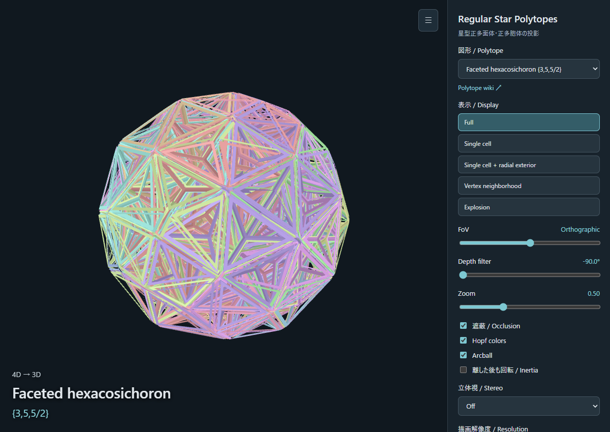

*Created with ChatGPT (Codex).*

# Regular Star Polytopes

Explore all four regular star polyhedra and all ten regular star polychora and exceptional flag-transitive regular compounds through interactive projections. Rotate them, change the perspective, and look inside their intersecting surfaces.

## Controls

- **Polyhedra (3D → 2D):** drag to rotate the shape in three dimensions.
- **Polychora (4D → 3D):** left-drag for ordinary 3D rotation; right-drag or use two fingers for 4D rotation.
- **Arcball** tilts the rotation axis according to the pointer position. It is off by default.
- **FoV** changes the projection's field of view. Zero gives an orthographic projection; both positive and negative angles are supported.
- Use the mouse wheel or **Zoom** to change the image size.
- **Depth filter** hides surface pieces by their projected depth, revealing the interior of a polychoron.
- **Inertia** continues the rotation after release. **Pause** stops it; **Reset** restores the starting orientation.
- **Stereo** offers parallel and cross-eyed viewing. **Eye spacing** adjusts the separation between the two views.
- **Hopf colors** groups the cells of the 120-cell family into twelve rings. Inner sides are shaded more darkly.
- **Resolution** adjusts image quality. Large shapes may benefit from a lower setting.
- **Copy view URL** shares the selected shape, display mode, orientation, projection, stereo settings, and continuing rotation.

## Display modes

- **Full:** the complete surface with geometric occlusion.
- **Single cell / Single face:** one original cell or face, including portions normally hidden inside the shape.
- **Single cell / face + radial exterior:** that cell or face and the surface pieces farther outward in the same directions from the shape's center.
- **Vertex neighborhood:** a neighborhood around a vertex. Numbered choices distinguish geometrically different vertex types.
- **Explosion:** separates the original cells or faces while preserving the overall radius before projection. The slider ends at the separation where the underlying geometry no longer intersects.

Surfaces are drawn with margins and hollow interiors so that their structure remains visible. Turn off **Occlusion** to see how the surfaces overlap.

## Projection and hidden surfaces

Projection reduces a shape by one dimension: a polyhedron becomes a flat image, while a polychoron becomes a three-dimensional object. Rotation changes which parts overlap in that projection.

Hidden surfaces are removed geometrically. A clipping plane is described by a direction perpendicular to it—a *normal*—and a threshold marking its position. Testing which side of several planes a point lies on identifies regions that should be hidden. The viewer performs these tests for the pixels of the projected surface, using the shape's solid geometry to determine which parts block the view. Symmetry lets many repeated pieces share the same calculations.

Based on [CRF-Polychoron-Viewer](https://github.com/dearsip/CRF-Polychoron-Viewer). Each shape's **Polytope wiki** link provides further details. This project also draws inspiration from [nan.ma/star](https://www.nan.ma/star/#/). See [NOTICE.md](NOTICE.md) for credits and licenses.
